# Santo Hotel — Entity Relationship Diagram

```mermaid
erDiagram
  ORGANIZATIONS ||--o{ HOTELS : owns
  ORGANIZATIONS ||--o{ ORGANIZATION_MEMBERS : has
  USERS ||--o{ ORGANIZATION_MEMBERS : joins
  ORGANIZATION_MEMBERS ||--o{ ORGANIZATION_MEMBER_HOTELS : scopes
  HOTELS ||--o{ ORGANIZATION_MEMBER_HOTELS : grants
  HOTELS ||--o{ LISTING_REVIEWS : reviewed
  HOTELS ||--o{ PUBLIC_SLUG_REDIRECTS : redirects
  ORGANIZATIONS ||--o{ BOOKINGS : records
  HOTELS ||--o{ BOOKINGS : hosts
  HOTELS ||--o{ ROOM_TYPES : offers
  ORGANIZATIONS ||--o{ ROOM_TYPES : owns
  HOTELS ||--o{ ROOMS : contains
  ROOM_TYPES ||--o{ ROOMS : "has physical"
  ROOM_TYPES ||--o{ RATES : "priced by"
  ROOM_TYPES ||--o{ ROOM_IMAGES : "shown by"
  ROOM_TYPES ||--o{ ROOM_TYPE_AMENITIES : equipped
  AMENITIES ||--o{ ROOM_TYPE_AMENITIES : "used in"
  GUESTS ||--o{ BOOKINGS : makes
  USERS ||--o{ BOOKINGS : "created by (staff)"
  USERS ||--o{ AUDIT_LOGS : performs
  PROMOTIONS ||--o{ BOOKINGS : discounts
  HOTELS ||--o{ PROMOTIONS : scopes
  BOOKINGS ||--o{ BOOKING_ROOMS : allocates
  ROOMS ||--o{ BOOKING_ROOMS : "allocated as"
  BOOKINGS ||--o{ PAYMENTS : "paid by"
  BOOKINGS ||--o{ NOTIFICATIONS : triggers
  ORGANIZATIONS ||--o{ AMENITIES : scopes
  ORGANIZATIONS ||--o{ SITE_CONTENT : scopes
  HOTELS ||--o{ SITE_CONTENT : scopes
  ORGANIZATIONS ||--o{ PAYMENTS : reports
  HOTELS ||--o{ PAYMENTS : reports
  ORGANIZATIONS ||--o{ AUDIT_LOGS : scopes
  HOTELS ||--o{ AUDIT_LOGS : scopes

  ORGANIZATIONS {
    uuid id PK
    text name
    text slug UK
    enum status
    text email
    text phone
    text country
  }
  ORGANIZATION_MEMBERS {
    uuid id PK
    uuid organization_id FK
    uuid user_id FK
    enum role
    enum status
  }
  ORGANIZATION_MEMBER_HOTELS {
    uuid member_id PK_FK
    uuid hotel_id PK_FK
  }
  HOTELS {
    uuid id PK
    uuid organization_id FK
    text name
    text slug UK
    text timezone
    text currency
    enum publication_status
    enum verification_status
    enum location_verification
    enum location_precision
  }
  USERS {
    uuid id PK
    text email UK
    text password_hash
    enum role "ADMIN, STAFF"
    enum platform_role "nullable"
    bool is_active
  }
  GUESTS {
    uuid id PK
    text first_name
    text last_name
    text email
    text phone
    text id_type
    text id_number
  }
  ROOM_TYPES {
    uuid id PK
    uuid hotel_id FK
    uuid organization_id FK "nullable during backfill"
    text name UK
    text slug UK
    int max_adults
    int max_children
    decimal base_price
    enum status "ACTIVE, INACTIVE"
  }
  ROOMS {
    uuid id PK
    uuid room_type_id FK
    uuid hotel_id FK "nullable during backfill"
    text room_number UK
    int floor
    enum status "RoomStatus"
  }
  AMENITIES {
    uuid id PK
    uuid organization_id FK "nullable"
    enum scope "PLATFORM, TENANT"
    text name UK
    text description
  }
  ROOM_TYPE_AMENITIES {
    uuid room_type_id PK_FK
    uuid amenity_id PK_FK
  }
  ROOM_IMAGES {
    uuid id PK
    uuid room_type_id FK
    text url
    int sort_order
  }
  RATES {
    uuid id PK
    uuid room_type_id FK
    text name
    decimal amount
    text currency
    date start_date
    date end_date
    enum status "ACTIVE, INACTIVE"
  }
  BOOKINGS {
    uuid id PK
    uuid hotel_id FK "nullable during backfill"
    uuid organization_id FK "nullable during backfill"
    text currency "nullable during backfill"
    json terms_snapshot
    text booking_reference UK
    uuid guest_id FK
    uuid promotion_id FK "nullable"
    text promotion_code "snapshot"
    date check_in
    date check_out
    int adults
    int children
    decimal subtotal
    decimal taxes
    decimal fees
    decimal discount
    decimal total
    enum booking_status "BookingStatus"
    enum payment_status "PaymentStatus"
    uuid created_by_user_id FK "nullable"
  }
  BOOKING_ROOMS {
    uuid id PK
    uuid hotel_id FK "nullable during backfill"
    text room_type_name_snapshot
    text room_type_slug_snapshot
    uuid booking_id FK
    uuid room_id FK
    decimal nightly_rate "historical snapshot"
    int nights
    decimal room_total "historical snapshot"
  }
  PAYMENTS {
    uuid id PK
    uuid hotel_id FK "nullable during backfill"
    uuid organization_id FK "nullable during backfill"
    uuid booking_id FK
    text provider
    text provider_reference UK
    decimal amount
    text currency
    enum status "PaymentStatus"
    decimal refunded_amount
    timestamptz paid_at
    timestamptz refunded_at
  }
  PROMOTIONS {
    uuid id PK
    uuid hotel_id FK "nullable during backfill"
    text code UK
    enum type "PERCENTAGE, FIXED_AMOUNT"
    decimal value
    timestamptz start_at
    timestamptz end_at
    int max_uses
    enum status "ACTIVE, INACTIVE"
  }
  NOTIFICATIONS {
    uuid id PK
    uuid hotel_id FK "nullable during backfill"
    uuid organization_id FK "nullable during backfill"
    uuid booking_id FK "nullable"
    enum channel "EMAIL, SMS, WHATSAPP"
    text recipient
    text subject
    text body
    enum status "PENDING, SENT, FAILED"
    timestamptz sent_at
  }
  AUDIT_LOGS {
    uuid id PK
    uuid organization_id FK "nullable"
    uuid hotel_id FK "nullable"
    uuid user_id FK "nullable"
    text actor_type
    uuid actor_guest_id
    text ip_address
    text purpose
    text outcome
    text action
    text entity_type
    text entity_id
    json old_values
    json new_values
    timestamptz created_at
  }
  LISTING_REVIEWS {
    uuid id PK
    uuid hotel_id FK
    enum from_status
    enum to_status
    text decision_reason
    uuid reviewer_user_id
    timestamptz decided_at
  }
  PUBLIC_SLUG_REDIRECTS {
    uuid id PK
    text entity_type
    text from_slug UK
    uuid hotel_id FK
    text target_slug
  }
  SITE_CONTENT {
    text key PK
    enum scope
    uuid organization_id FK "nullable"
    uuid hotel_id FK "nullable"
    text title
    text body
  }
```

M1 adds the tenant foundation additively. Historical owner columns remain nullable
until the M2 reconciliation/backfill; hotel ownership is backfilled to the initial
Santo organization. Authorization and cross-tenant constraints are delivered in later
phases, so these columns do not by themselves enable multi-tenant checkout.

## Cardinality summary

| Relationship | Type | Notes |
| ------------ | ---- | ----- |
| Organization → Hotels | 1—* | tenant ownership boundary |
| Organization → Members | 1—* | user memberships are unique per organization |
| Member ↔ Hotel | *—* | explicit property scope |
| Hotel → Room Types | 1—* | property catalog |
| Room Type → Room | 1—* | one category, many physical rooms |
| Room Type → Rate | 1—* | date-bounded pricing |
| Room Type ↔ Amenity | *—* | via `room_type_amenities` |
| Room Type → Room Image | 1—* | category photography |
| Guest → Booking | 1—* | guest history |
| User → Booking | 1—* | staff-created/manual bookings (nullable) |
| Promotion → Booking | 1—* | nullable; applied values snapshotted |
| Booking → Booking Room | 1—* | one reservation, many rooms |
| Room → Booking Room | 1—* | same room across many bookings |
| Room ↔ Booking → Room Night | *—* | `(room_id, night)` primary key — the double-booking guard |
| Booking → Payment | 1—* | one booking, many transactions/refunds |
| Booking → Notification | 1—* | confirmations, reminders |
| User → Audit Log | 1—* | accountability trail |

## Key design decisions

- **Room type vs physical room** — shared attributes on `room_types`, inventory on `rooms`.
- **Historical snapshots** — `booking_rooms.nightly_rate`/`room_total`, booking totals and
  `promotion_code` preserve what was actually charged; current rates can change freely.
- **Availability-friendly indexes** — `rooms(status, room_type_id)`,
  `booking_rooms(room_id)`, `bookings(check_in, check_out, booking_status)` support the
  P4 overlap query.
- **`room_nights` is the double-booking guard (P4)** — one row per physical room per
  calendar night, `PRIMARY KEY (room_id, night)`; the checkout transaction inserts the
  stay's nights, so a second allocation of the same night fails at the database no matter
  what the application layer does. Nights are released by a `bookings` trigger on
  `CANCELLED` and by the pending-hold sweep. The originally planned
  `EXCLUDE USING gist (room WITH = AND daterange(...) && ...)` constraint was dropped:
  it needs the `btree_gist` extension, which the PGlite development database cannot
  load — the ledger table gives the same guarantee (one row per night) with plain SQL.
  Overlap math lives in `src/server/availability/overlap.ts` and is proven equivalent to
  the night expansion in `tests/availability/overlap.test.ts`.
- **Deletion behavior** — guests/bookings/rooms are `RESTRICT` (audit-safe); booking
  rooms cascade with their booking; user references on bookings/audits become `NULL`.
- **No card data** — payments store provider references only.
